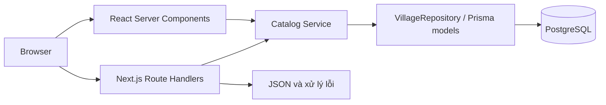

# Kiến trúc và nghiệp vụ Bát Tràng

Hộ nghệ nhân có một hồ sơ xưởng thuộc làng, trưng bày sản phẩm và ghi các mốc chế tác theo lô. Khách tham quan dùng tọa độ và trạng thái đón khách của xưởng. Người mua sỉ gửi yêu cầu, các hộ được mời chào số lượng, giá và hạn giao. Ban quản lý duyệt xưởng, đăng tin và điều phối phân bổ giữa nhiều hộ.

| Thư mục          | Trách nhiệm                                                          |
| ---------------- | -------------------------------------------------------------------- |
| src/app          | Layout, clean URL, Server Components và HTTP controller trong api/v1 |
| src/services     | Quy tắc hiển thị xưởng và lô cho cả trang và API                     |
| src/repositories | CRUD qua đối tượng, nhận Prisma client hoặc transaction              |
| src/lib          | Kết nối server-only dùng lại pool và định dạng HTTP chung            |
| prisma           | Schema tập trung, migration có phiên bản, seed                       |
| tests            | Kiểm thử hợp đồng và tích hợp                                        |

## Quan hệ và ranh giới tích hợp

- User có một trong ba vai trò. ArtisanProfile gắn duy nhất với một User và một CraftVillage. Cặp tọa độ trên hồ sơ là vị trí ghim. Service công khai chỉ đọc xưởng được duyệt thuộc tài khoản nghệ nhân.
- Product thuộc xưởng. ProductionBatch thuộc sản phẩm và có mã duy nhất dùng chung cho cả lô. ProductionLog lưu thời điểm tuyệt đối và danh sách tham chiếu ảnh. API sắp các mốc theo thời gian. Module upload chịu trách nhiệm lưu file và xác minh quyền.
- QuoteRequest thuộc người mua. QuoteRecipient xác định các xưởng được mời. Mỗi cặp yêu cầu–xưởng có tối đa một QuoteBid. acceptedQuantity cho phép chia đơn vào nhiều xưởng. Module điều phối phải cập nhật số lượng nhận cùng trạng thái trong một transaction, kiểm tra version và tổng phân bổ trước khi commit.
- Chuỗi trạng thái là DRAFT_REQUEST → SENT_TO_ARTISANS → ARTISANS_BIDDING → BUYER_ACCEPTED → IN_PRODUCTION → DELIVERED. Task báo giá chịu trách nhiệm thực thi bước chuyển và quyền của từng vai trò.
- CommunityNews liên kết với tác giả. Module quản trị kiểm tra quyền Admin trước khi đăng. Các chức năng ghi dùng service server-side để kiểm tra vai trò và sở hữu.
- Đổi địa chỉ database qua DATABASE_URL. Mã giao diện chỉ gọi service. Ví dụ CRUD qua đối tượng có trong tests/database.test.ts.
