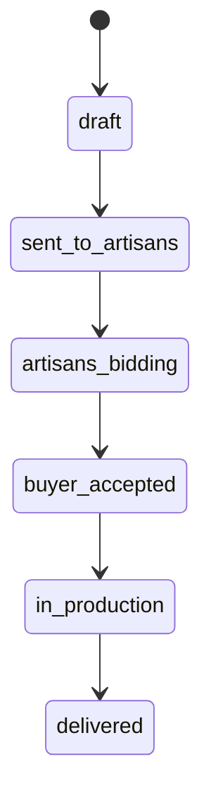
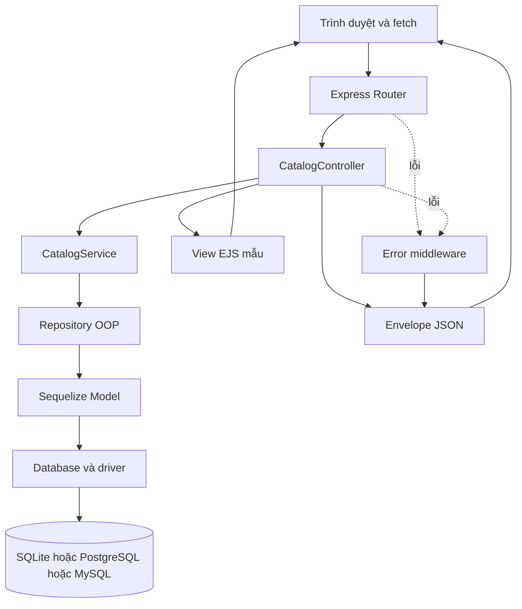

# Kiến trúc vCraft Bát Tràng

## Phạm vi nghiệp vụ

vCraft phục vụ một làng nghề được lựa chọn là Làng gốm Bát Tràng. Một làng có nhiều hộ gia đình, mỗi hộ có nhiều sản phẩm và mỗi sản phẩm có nhiều lô chế tác. Ví dụ sản phẩm cốc men lam có lô BT-2026-001 gồm 300 chiếc. Toàn bộ chiếc cốc trong lô dùng chung liên kết truy xuất theo mã lô.

| Vai trò | Trách nhiệm trong sản phẩm đầy đủ |
| --- | --- |
| Admin | Kiểm duyệt hộ gia đình, quản lý thông báo cộng đồng và điều phối |
| Artisan | Quản lý hồ sơ xưởng, sản phẩm, lô, nhật ký và gửi chào giá |
| Buyer | Xem triển lãm, bản đồ, truy xuất lô và gửi/chấp nhận yêu cầu báo giá |

Hồ sơ nghệ nhân có trạng thái duyệt riêng với trạng thái tài khoản. Danh mục công khai chỉ hiển thị xưởng đã duyệt có tài khoản artisan đang hoạt động. Sản phẩm công khai còn phải ở trạng thái published. Các quy tắc này được CatalogService dùng cho cả JSON và trang web.

Một yêu cầu báo giá thuộc một buyer và được gửi đến nhiều xưởng qua quote_request_recipients. Mỗi xưởng có tối đa một chào giá trên một yêu cầu. Các trạng thái chuẩn đã được lưu trong schema để nhóm xây dựng state machine ở task 6.2.



Task 1.1–1.3 cung cấp model và cột version cho luồng này. Service chuyển trạng thái, phân quyền, kiểm tra năng lực xưởng và khóa đơn khi chấp nhận sẽ được triển khai ở các task nghiệp vụ tương ứng.

## Sơ đồ hệ thống



View nhận dữ liệu từ Controller và escape bằng `<%= ... %>`. View không gọi ORM. Controller nhận tham số HTTP, gọi Service và dựng response. Service chịu trách nhiệm nghiệp vụ hiển thị. Repository chứa thao tác dữ liệu và nhận transaction. Database tạo kết nối và quản lý transaction theo dialect.

`createContext` ghép dependency tường minh. `createApp` tạo ứng dụng mà không tự mở cổng, nên có thể dùng trong test và tích hợp. Không dùng singleton CSDL toàn cục.

## Mẫu thêm nghiệp vụ

```javascript
// Trong một Service, gọi repository và truyền transaction cho mọi thao tác liên quan.
await database.transaction(async transaction => {
  const request = await repositories.quote_requests.findById(requestId, {
    transaction,
    lock: transaction.LOCK.UPDATE,
  });
  // Kiểm tra quyền, trạng thái và số lượng tại đây trước khi cập nhật.
  // Chỉ cho phép field do service lựa chọn, không truyền thẳng req.body vào ORM.
  await repositories.quote_requests.update(request.id, {
    status: nextStatus,
  }, { transaction });
});
```

Ví dụ trên thể hiện vị trí tổ chức code. Khi làm task 6.2, kiểm tra và cập nhật phải cùng transaction. SQLite không hỗ trợ row lock như PostgreSQL/MySQL. SQLite dùng transaction khóa ghi và cần xử lý xung đột/thử lại. QuoteRequest bật optimistic locking qua version khi cập nhật instance, nhưng việc kiểm tra chuyển trạng thái vẫn thuộc Service.

## Quy ước chung

- JavaScript CommonJS, lớp dùng PascalCase, hàm/biến dùng camelCase.
- Tên cột CSDL và field JSON dùng snake_case. ID là UUID, mã lô và slug có unique constraint.
- Route web dùng `/artisan/:slug`, `/trace/:code`. API dùng `/api/v1` và danh từ số nhiều.
- Ngày giờ trả về ISO 8601. Deadline là YYYY-MM-DD. Tiền lưu DECIMAL theo VNĐ, frontend chuyển định dạng khi hiển thị.
- API trả `{ status, message, data }`. Dùng HTTP status code thật, lỗi tập trung tại middleware.
- Migration là nguồn khởi tạo CSDL. Khi thay đổi schema, thêm migration và cập nhật model. Giữ snapshot schema-v1 để migration cũ có thể chạy lại.
- Controller mở rộng về tài khoản và báo giá phải đặt middleware xác thực và phân quyền trước handler ghi dữ liệu.

Cách tổ chức migration dựa trên [Sequelize migrations](https://sequelize.org/docs/v6/other-topics/migrations/). Xử lý lỗi async tuân theo [Express error handling](https://expressjs.com/en/guide/error-handling/).
