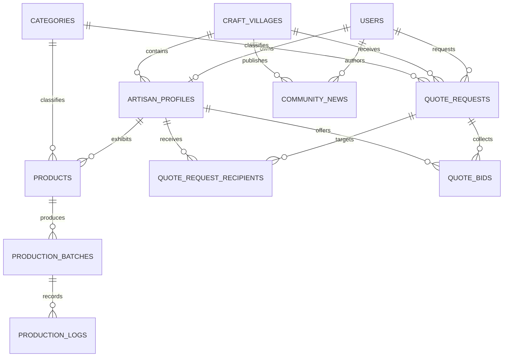

# Lược đồ dữ liệu vCraft

Migration `202611220001-initial-schema.js` tạo 11 bảng theo đúng thứ tự foreign key. Mỗi bảng có UUID id, created_at và updated_at. Sequelize CLI có thêm SequelizeMeta để ghi lịch sử migration.

| Bảng | Các trường chính và ràng buộc |
| --- | --- |
| users | email unique, password_hash, role admin/artisan/buyer, status active/locked |
| craft_villages | name, slug unique, address, latitude, longitude |
| artisan_profiles | user_id unique, village_id, workshop_name, slug unique, family_history, story, tọa độ pin, is_open, approval_status, images, certificates |
| categories | name, slug unique |
| products | artisan_id, category_id, name, slug unique, reference_price, story, images, status |
| production_batches | product_id, code unique, quantity, status, started_at, completed_at |
| production_logs | batch_id, title, description, occurred_at, position, images, unique(batch_id, position) |
| quote_requests | buyer_id, village_id, category_id, specifications, quantity, budget, deadline, status, version |
| quote_request_recipients | request_id, artisan_id, unique(request_id, artisan_id) |
| quote_bids | request_id, artisan_id, unit_price, quantity, completion_date, notes, status, unique(request_id, artisan_id) |
| community_news | author_id, village_id, title, slug unique, content, is_pinned, published_at |

Pin được lưu trực tiếp trên ArtisanProfile để tránh hai bản tọa độ cho một xưởng. Một sản phẩm có thể được sản xuất nhiều lần, mỗi lần là một ProductionBatch. URL truy xuất được suy ra từ code nên mọi chiếc cùng lô dùng chung URL. ProductionLog là các bản ghi có thứ tự, API trả về mảng logs với từng mảng ảnh.

Ảnh lưu dưới dạng mảng URL JSON. Chứng nhận lưu dưới dạng mảng JSON để module hồ sơ có thể bổ sung tên và URL chứng nhận. Model kiểm tra đây là mảng. Module upload sẽ kiểm tra nội dung file, dung lượng và URL lưu trữ.

Foreign key dùng RESTRICT khi xóa để giữ lịch sử truy xuất và báo giá. Dùng archive/locked khi ngừng công khai. Các kiểm tra role, trạng thái, số lượng dương, giá không âm và tọa độ nằm trong miền hợp lệ chạy qua validation OOP. Unique và foreign key được thực thi ở CSDL. Service nghiệp vụ phải kiểm tra user_id là artisan, buyer_id là buyer và author_id là admin. Foreign key chỉ kiểm tra bản ghi tồn tại.

## Đổi hệ quản trị

SQLite là cấu hình mặc định đã kiểm thử. Với PostgreSQL, cài `npm install pg pg-hstore`, đặt DB_DIALECT=postgres và điền thông tin DB trong `.env`. Với MySQL, cài `npm install mysql2`, đặt DB_DIALECT=mysql. Sau đó tạo database rỗng bằng công cụ quản trị và chạy `npm run setup`.

Model và Repository sử dụng cùng API Sequelize. Không có SQL thô trong View/Controller. Cần chạy kiểm tra tích hợp trên hệ quản trị đích trước khi nhóm chốt môi trường demo. DDL của MySQL có cơ chế commit riêng, cần kiểm tra trạng thái migration khi kết nối bị gián đoạn giữa quá trình tạo bảng.

Giá DECIMAL có thể được driver trả về số hoặc chuỗi. Frontend có thể dùng `Number(reference_price)` khi định dạng, đồng thời giữ phép tính tiền ở backend bằng biểu diễn chính xác khi làm module báo giá.
